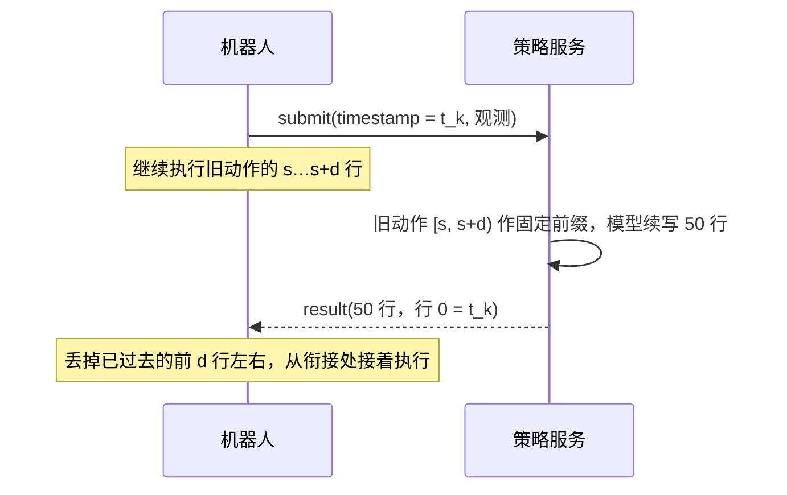

# 策略服务 HTTP 接口（Model API）

Oct 22, 2026（本次更新：图像传输新增 `extra_info.image_format`，可发原始像素；在线模型都改为服务端 RTC）

一个网关按 URL 前缀转发到各个模型服务：`http://<gateway>/<端点>/...`。所有端点的请求/回复格式**相同**，客户端换模型只改 URL 前缀。

- 协议：`manifold_msg` 1.4.1（相对 1.4.0 只多了回复里的 `extra_info`）。图像格式由请求的 `extra_info.image_format` 选择，协议库本身不变（§3.1）。
- 健康检查：`GET /<端点>/` → 200；后端停止时返回 502。
- 图像传输的设计、测速和取舍见 [robot-image-transport](../robot-image-transport/README.md)。

## 1. 当前在线的模型

GPU 为 24 GB 4090，同时最多 2 个服务在线。端点名另行告知。

| 模型 | 手臂 / 状态维 | 动作 | 目标框叠加 | 回复 `extra_info` | 图像格式 |
|---|---|---|---|---|---|
| 双臂 pi05 + 训练式 RTC | 双臂，16D（每臂 7 关节 + 夹爪） | 左右各 50×8 | 两个腕部各画面积最大的框（YOLO，不跟踪） | `target_bbox` = `[左腕框, 右腕框]` | `jpeg/base64`、`pixel/binary` |
| 左臂 pi05 RECAP + 训练式 RTC | 左臂，8D | 左臂 50×8；右臂保持观测值 | 左腕目标框（YOLO + 跟踪） | `target_bbox` = 左腕框 | `jpeg/base64`、`pixel/binary` |

- 两者都没有技能头，都**没有**空闲超时重置（§6）。
- prompt 由服务端固定为训练时的值（形如 `pick the red and white box, place it on the tray operator=<name>`），请求里的 `prompt` 被忽略。
- `pixel/binary` 只有 Oct 22 及之后部署的服务支持；更早的服务收到它返回 HTTP 500（§3.1）。

## 2. 调用流程

```
POST /<端点>/submit          # 提交观测，立即返回 {"status": "success", ...}
GET  /<端点>/result/<ts>     # 轮询：202 = 处理中，200 = 完成（含动作）
```

- `<ts>` = 提交时 `timestamp` 的原值。
- 延迟（4090，单请求，经网关）：JPEG 约 0.10 s；`pixel/binary` 约 0.13 s（多出的是 3.8 MB 请求体的传输与解析）。
- 服务（重）启后会自动预热；没有预热时第一次请求要编译模型，需 15~50 s。

## 3. 请求体（`POST /submit`，JSON）

| 字段 | 类型 | 必填 | 说明 |
|---|---|---|---|
| `timestamp` | float | ✔ | 请求 ID，**同时是这帧观测的采集时间（秒）**。正常单调递增；**比上一次小 = 新回合**（§6）。RTC 用相邻两次的差值算动作衔接（§6.1），所以必须是真实时间、单位秒 |
| `prompt` | string | ✖ | 服务端忽略 |
| `img_front` / `img_left` / `img_right` | list[frame] | ✔ | 头部 / 左腕 / 右腕相机，服务端只取最后一帧。帧格式见 §3.1 |
| `left_arm_joint_state` / `right_arm_joint_state` | list[list[8]] | ✔ | 7 关节（弧度，绝对值）+ 1 夹爪宽度；只取最后一帧。单臂模型用右臂当前值保持右臂 |
| `img_*_depth` / `*_joint_velocity` / `*_joint_effort` / `*_end_pose` | list | ✖ | 空表即可 |
| `is_euler` | bool | ✖ | 默认 false |
| `extra_info` | object | ✖ | 上行自由 JSON（对象或其 JSON 字符串）。服务端读其中的 `image_format`（§3.1）和 `target_bbox`（§5.2），其余键接收但不使用 |

### 3.1 图像帧格式（`extra_info.image_format`）

帧结构都是 `{"data": ..., "shape": [...]}`；`data` 的含义由 `extra_info.image_format` 决定，**对本次请求的所有相机生效**。

| `extra_info.image_format` | 帧的 `data` | `shape` |
|---|---|---|
| 不带 / `""` / `"jpeg/base64"`（默认） | base64(JPEG 字节)，**BGR**，原始分辨率（当前 640×480） | 原样传，服务端不依赖 |
| `"pixel/binary"` | base64(原始像素字节)：彩色为 **BGR** uint8 `[H, W, 3]`；深度为小端 uint16 `[H, W]`；行优先、连续、无行尾填充（`np.ascontiguousarray(img).tobytes()`） | **必须**是图像本身的尺寸；字节数必须正好等于 H×W×3（深度 H×W×2） |

- 不带 `image_format` 的旧客户端行为完全不变。
- `pixel/binary`：**客户端不缩放、不补边、不转颜色**，直接发相机原图。缩放、补边、裁剪和 BGR→RGB 全部由服务端按各模型的训练方式完成。
- 现有客户端库会先把图像缩放到 `/info` 给的尺寸再编码；发原始像素时要绕开这一步。
- 出错即拒绝，服务端不猜格式：`image_format` 不认识（如 `"png"`）、`shape` 不对、字节数与 `shape` 不符、base64 非法，`/submit` 都返回 **HTTP 500** 和 `{"status": "error", "message": "<原因>"}`，该请求不进入推理。
- 旧服务端收到 `pixel/binary` 帧也返回 500。客户端可以据此回退：收到 500 就去掉 `image_format`、改回 JPEG 重发。
- 取舍：原始像素在机器人端几乎不花时间（JPEG q100 编码实测约 160 ms），但每次请求约 2.8 MB（JSON 体 3.8 MB），**要求机器人到服务器全程千兆有线**；百兆或 Wi‑Fi 下会比 JPEG 更慢。

## 4. 回复体（`GET /result/<ts>` → 200）

| 字段 | 类型 | 说明 |
|---|---|---|
| `timestamp` | float | 回显请求的 `timestamp` |
| `gen_action_rate` | int | 50 |
| `left_arm_actions` / `right_arm_actions` | list[50] | 每项 `{"joint_state": [8], "joint_velocity": [], "joint_effort": [], "end_pose": [], "is_euler": false}`；`joint_state` = 7 关节绝对目标（弧度）+ 1 夹爪。行 0 对应请求那帧观测的时刻，之后按 30 fps |
| `ctrl_mode` | int | 2（关节位置控制） |
| `extra_info` | object | **可选**，见 §5。没有可回显的内容时整个键不出现 |

## 5. `extra_info`（回复）

键随端点不同，以后可能加新键。

### 5.1 键一览

| 键 | 类型 | 出现在 | 含义 |
|---|---|---|---|
| `target_bbox` | 见右 | 带目标框叠加的端点 | 本次画在腕部图上、送进模型的框（像素 `[x1, y1, x2, y2]`），没画框为 `null`。单腕模型：一个框；双腕模型：长度 2 的列表 `[左腕框, 右腕框]`，每项可单独为 `null` |
| `skill` / `model_skill` / `phase_progress` / `skill_probs` | | 带技能头的端点（当前在线的都没有） | 技能名、技能头估计、进度 0~1、各技能概率 |

### 5.2 `target_bbox`

**坐标**：像素，基于对应腕部图（`img_left` / `img_right`）的**原始分辨率**（当前 640×480），不是模型输入的 224×224；两种图像格式下相同。原点左上角，x 向右、y 向下；整数，已裁剪到图像范围内。

**客户端自带框（优先，仅单腕模型）**：请求的 `extra_info.target_bbox` 若存在且合法，服务端直接画这个框，不跑检测。
- 格式：`[x1, x2, y1, y2]`，**比例**（0~1）。注意顺序是 x1, x2, y1, y2，与回复的像素 `[x1, y1, x2, y2]` 不同。
- 不合法（不满足 `0 ≤ x1 < x2 ≤ 1`、`0 ≤ y1 < y2 ≤ 1`）时退回检测。
- 双腕模型忽略请求里的框，两个腕部都用检测。

**服务端检测**（请求没带框时，每次请求、推理之前）：YOLO 微调检测器，置信度阈值 0.5。
- 双腕模型（不跟踪）：左右腕各自检测，每帧取面积最大的框，与训练标注方式一致。
- 单腕模型（跟踪）：没有目标时取面积最大的框；已有目标时在上一次目标中心 0.7 倍框长边范围内找，优先同一跟踪 ID，否则取中心最近的；找不到时下一次重新选；新回合清空。
- 画框：绿色 (0,255,0)，3 px，画在原始分辨率的腕部图上，然后才缩放进模型。

**为 `null`**：没有框达到 0.5，或目标丢失且这次没有可选的框；此时对应腕部图上也没画框。

### 5.3 示例

```json
"extra_info": {"target_bbox": [287, 142, 396, 319]}            // 单腕，画了框
"extra_info": {"target_bbox": null}                            // 单腕，没画框
"extra_info": {"target_bbox": [[287, 142, 396, 319], null]}    // 双腕，左腕有框、右腕没有
```

### 5.4 客户端读取约定

- 用 `rep.get("extra_info") or {}` 读取：缺失的键表示该端点不提供，不是出错。
- 忽略不认识的键。
- `target_bbox` 为 `null` 时不要沿用上一次的框当作模型看到的框。
- 双腕模型的 `target_bbox` 是列表的列表；可以看第一个元素是不是列表来区分。

## 6. 回合（episode）规则

满足任一条件，服务端就把这次请求当作**新回合**：清空目标框跟踪和 RTC 的上一段动作。

- `timestamp` 比上一次请求小。
- 距上一次请求超过 `reset_after_idle_s` 秒——**当前在线的模型都没设这条**，等待不会重置。

所以开始新回合的方法是让 `timestamp` 回退。

### 6.1 服务端 RTC

不改协议，客户端约定如下：

- 请求在途时，机器人**继续执行上一段动作**；新动作到达后，**丢掉覆盖「观测时刻 → 现在」这段时间的前几行**（行 0 = 观测时刻，30 fps），从之后的行接着执行。
- 服务端记住上一次回复的动作和它的 `timestamp`。新请求时算 `s = round((本次 timestamp − 上次 timestamp) × 30)`（机器人当时执行到旧动作的第几行）和 `d = ceil(延迟 × 30)`（最多 10 行），把旧动作的 `[s, s+d)` 行当作新动作的固定前缀，模型从那里续写，所以新动作的第 d 行起与机器人正在走的轨迹衔接。
- 因此 `timestamp` 必须是观测采集时间（秒）。旧动作覆盖不到 `[s, s+d)`（例如两次请求间隔超过约 1.3 s）时，本次不加前缀，等同普通推理。
- 新回合清空上一段动作，第一次请求不加前缀。



## 7. 示例客户端

```python
import base64, time, cv2, numpy as np, requests

BASE = "http://<gateway>/<端点>"   # 换模型只改这里
PIXEL = True                       # False：JPEG（默认格式）

def jpeg_frame(img_bgr):
    ok, jpg = cv2.imencode('.jpg', img_bgr, [int(cv2.IMWRITE_JPEG_QUALITY), 100])
    return {"data": base64.b64encode(jpg).decode(), "shape": list(img_bgr.shape)}

def pixel_frame(img_bgr):
    """相机原图，HxWx3 uint8 BGR。不缩放、不补边、不转颜色。"""
    img = np.ascontiguousarray(img_bgr)
    return {"data": base64.b64encode(img.tobytes()).decode(), "shape": list(img.shape)}

def request(fmt_pixel):
    frame = pixel_frame if fmt_pixel else jpeg_frame
    return {
        "timestamp": ts,                               # 观测采集时间（秒）
        "prompt": "",                                  # 服务端忽略
        "img_front": [frame(front_img)], "img_left": [frame(left_img)], "img_right": [frame(right_img)],
        "img_front_depth": [], "img_left_depth": [], "img_right_depth": [],
        "left_arm_joint_state": [left_joints_8],       # 7 关节弧度 + 1 夹爪
        "right_arm_joint_state": [right_joints_8],
        "left_arm_joint_velocity": [], "right_arm_joint_velocity": [],
        "left_arm_joint_effort": [], "right_arm_joint_effort": [],
        "left_end_pose": [], "right_end_pose": [],
        "is_euler": False,
        "extra_info": {"image_format": "pixel/binary"} if fmt_pixel else {},
    }

ts = time.time()
r = requests.post(f"{BASE}/submit", json=request(PIXEL))
if r.status_code == 500 and PIXEL:                     # 旧服务端或帧有误：改回 JPEG
    print(r.text); r = requests.post(f"{BASE}/submit", json=request(False))
while (r := requests.get(f"{BASE}/result/{ts}")).status_code != 200:
    time.sleep(0.05)
rep = r.json()
left = [a["joint_state"] for a in rep["left_arm_actions"]]   # 50 × 8，行 0 = 观测时刻，30 fps
box = (rep.get("extra_info") or {}).get("target_bbox")      # 单腕：[x1, y1, x2, y2] 或 None；双腕：[左, 右]
```
