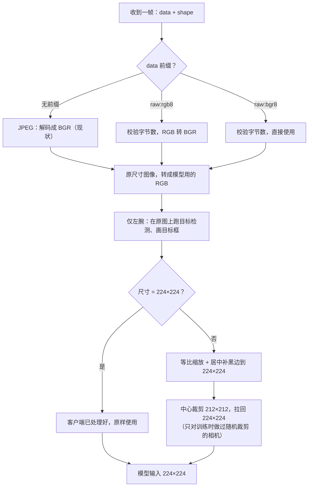

# 机器人图像传输：原始 RGB 与 JPEG 兼容方案

Oct 20, 2026

## 背景与目标

结论先行：机器人改为**直接发送原始 RGB 像素**（不做 JPEG、不做 PNG、不缩放），服务端按每帧的格式与尺寸自动处理；旧的 JPEG 请求继续可用，两种客户端可以并存。

- 现状：机器人每次请求对 3 路相机做 JPEG 编码（`cv2.imencode`，q100），实测约 **160 ms**，占掉一次推理往返的大头。
- 目标：把机器人端的图像处理降到接近 0，同时不改变模型看到的图像（与训练一致），也不破坏现有 JPEG 客户端。
- 范围：`/submit` 请求里的 `img_front` / `img_left` / `img_right` 三个图像字段；动作回复、`/result`、深度图字段不变。

## 结论：发原始 RGB，不要发 PNG

原始 RGB 在机器人端几乎不花时间，代价转移到网络：千兆有线下每次请求约 32 ms；PNG 编码比 JPEG 还慢 10–20 倍，在机器人上预计要 1.5–2.5 秒，是三者中最差的。

| 格式（3 路相机，640×512 + 2×640×480） | 每次请求体积 | 编码耗时（服务器 CPU 实测） | 编码耗时（机器人，按 50–80 倍估算） | 千兆网传输 | 百兆网传输 |
| --- | --- | --- | --- | --- | --- |
| **原始 RGB（推荐）** | 2.8 MB（base64 后 JSON 体 3.8 MB） | 拷贝 0.1 ms + base64 1.6 ms + JSON 4 ms | 待测（见「客户端实现」的测速脚本） | 约 32 ms | 约 320 ms |
| PNG（压缩级别 1，最快档） | 1.0–1.75 MB（原始的 37–63%） | 28–47 ms | 1.4–2.4 s | 9–15 ms | 90–150 ms |
| PNG（默认级别 6） | 0.9–1.7 MB | 97–119 ms | 5–10 s | 8–14 ms | 80–140 ms |
| JPEG q100（现状） | 0.35–0.68 MB | 2–3 ms | **160 ms（机器人实测）** | 3–6 ms | 30–60 ms |

- 测量方法：用机器人实际发来的 3 帧 640×480 画面，在推理服务器上用 OpenCV 测得；体积区间的下端是干净画面，上端是叠加了常见传感器噪声的画面（噪声越大 PNG 越压不动）。
- 机器人列的倍数来自 JPEG：同样 3 帧在服务器上 2–3 ms，机器人上 160 ms。PNG 与 JPEG 同样是计算密集型，倍数应当接近；base64 与 JSON 不一定按同样倍数变慢，所以需要在机器人上实测。
- 网络：推理服务器网口为 1 Gbit/s。原始 RGB 方案**要求机器人到服务器全程千兆有线**；百兆或 Wi‑Fi 下传输会比现在更慢。
- 服务端开销：解 base64 与取像素约 2 ms，比解 JPEG q100 的 6 ms 还少。
- 不缩放的原因：缩放同样耗 CPU，而且必须与训练的插值方式逐像素一致；左腕还要在原图上跑目标检测。缩放统一交给服务端。

## 请求格式：用 `data` 前缀区分 JPEG 与原始像素

帧结构不变，仍是 `{"data": ..., "shape": [H, W, 3]}`；只在 `data` 字符串开头加格式前缀。没有前缀 = 现在的 JPEG，所以旧客户端不用改。

| `data` 字段 | 含义 | 字节数要求 |
| --- | --- | --- |
| `<base64>`（无前缀） | JPEG，BGR，现状 | 任意 |
| `raw:rgb8:<base64>` | 原始像素，uint8，R-G-B 顺序 | 正好 H×W×3 |
| `raw:bgr8:<base64>` | 原始像素，uint8，B-G-R 顺序 | 正好 H×W×3 |

- 像素排列：行优先、HWC、连续内存，行尾无填充（numpy 的 `np.ascontiguousarray(img).tobytes()`）。相机驱动给的是什么顺序就声明什么，**机器人端不要做颜色转换**，服务端统一转成模型需要的 RGB。
- `shape` 必须是实际发送的 `[H, W, 3]`。与字节数对不上、前缀不认识、base64 非法、H 或 W 超过 4096，都会被拒绝：`/submit` 返回 HTTP 500 和 `{"status": "error", "message": "<原因>"}`，该请求不进入推理。服务端不会猜格式。
- 三路相机可以各自选格式，例如左腕发原始像素、另外两路暂时仍发 JPEG。每路只发最后 1 帧（服务端只用最后一帧）。
- 能力协商：支持新格式的服务端在 `GET /info` 里多返回 `"image_formats": ["jpeg", "raw:rgb8", "raw:bgr8"]`。客户端启动时读一次，没有这个字段就继续发 JPEG——这样同一个客户端可以连新旧两种端点。
- 为什么用前缀而不加新字段：协议库 `manifold_msg` 只把 `data` 和 `shape` 交给解码函数，前缀不需要改协议库；base64 字符集里没有 `:`，所以前缀不会与 JPEG 数据混淆。

## 服务端如何区分格式与尺寸

格式只影响解码一步，尺寸只影响缩放一步，两者互不相干：任何格式、任何尺寸的组合都合法。



正好 224×224 的帧视为客户端已经按训练方式处理好，原样送入；其他尺寸（640×512、640×480、224×168 等）都由服务端缩放、补边、裁剪，结果与客户端的参考实现逐像素一致。左腕在带目标框的模型上必须发 640×480 原图。

## 客户端实现

每路相机发**原始分辨率**的原始像素，机器人端只做一次拷贝和 base64。

| 相机 | 请求字段 | 发送尺寸 | 说明 |
| --- | --- | --- | --- |
| 头部 | `img_front` | 640×512 原图 | 服务端负责缩放、补边、中心裁剪 |
| 左腕 | `img_left` | 640×480 原图（**必须**） | 服务端在原图上跑目标检测、画目标框；回复里的 `target_bbox` 是这张图的像素坐标 |
| 右腕 | `img_right` | 640×480 原图 | 同头部 |

参考代码：

```python
import base64, numpy as np, requests

def raw_frame(img, order='rgb8'):
    """img: HxWx3 uint8，相机原始顺序（'rgb8' 或 'bgr8'），不做颜色转换。"""
    img = np.ascontiguousarray(img)
    assert img.dtype == np.uint8 and img.ndim == 3 and img.shape[2] == 3
    return {'data': f'raw:{order}:' + base64.b64encode(img.tobytes()).decode('ascii'),
            'shape': list(img.shape)}

# 启动时协商一次：旧服务端没有 image_formats，继续发 JPEG
formats = requests.get(f'{base}/info', timeout=2).json().get('image_formats', [])
use_raw = 'raw:rgb8' in formats

# request['img_front'] = [raw_frame(head_rgb)]
# request['img_left']  = [raw_frame(left_rgb)]
# request['img_right'] = [raw_frame(right_rgb)]
```

机器人端测速（请在机器人上跑一次，把输出发给我们）：

```python
import base64, json, time, numpy as np, cv2
ims = [np.random.randint(0, 256, s, np.uint8) for s in ((512, 640, 3), (480, 640, 3), (480, 640, 3))]
def ms(f, n=20):
    f(); t = time.perf_counter()
    for _ in range(n): f()
    return (time.perf_counter() - t) / n * 1000
body = lambda: json.dumps({'img': [base64.b64encode(i.tobytes()).decode('ascii') for i in ims]})
print('tobytes   %.1f ms' % ms(lambda: [i.tobytes() for i in ims]))
print('base64    %.1f ms' % ms(lambda: [base64.b64encode(i.tobytes()) for i in ims]))
print('b64+json  %.1f ms' % ms(body))
print('jpeg q100 %.1f ms' % ms(lambda: [cv2.imencode('.jpg', i, [cv2.IMWRITE_JPEG_QUALITY, 100]) for i in ims], 5))  # 随机噪声图上 JPEG 偏慢，仅作量级参考
```

- `b64+json` 低于约 30 ms：按本文的 JSON + base64 格式即可。
- 高于 30 ms：我们再增加一种**二进制请求体**（像素直接跟在请求里，不经过 base64 和 JSON，机器人端只剩内存拷贝，体积也小 25%），属于协议变更，需要双方另行确认。
- 顺便确认机器人网口是否千兆：Linux 上 `cat /sys/class/net/<网口>/speed` 应为 `1000`。

## 服务端实现计划

服务端改动约半天（含测试），只改我们自己的推理服务 `policy_server_ubt.py`，不改协议库 `manifold_msg`；现有 JPEG 客户端的结果逐像素不变。

1. **解码入口**：替换服务对象的单帧解码函数。`raw:rgb8:` / `raw:bgr8:` → 校验前缀、shape、字节数 → 取像素；无前缀 → 原来的 JPEG 解码。两条路径都输出同一种内部格式（与 JPEG 解码结果相同的 BGR），后面的流程不再区分格式。
2. **能力声明**：`/info` 增加 `image_formats`。
3. **尺寸处理**：已实现并上线到一个端点（见下一节），其余端点按各自训练配置开启中心裁剪。
4. **日志**：每次请求记录每路相机收到的格式与尺寸，便于联调。
5. **测试**：
   - 同一帧分别以 `raw:rgb8`、`raw:bgr8` 发送，模型输入必须逐像素相同；
   - JPEG 请求的模型输入与改动前逐像素相同；
   - 字节数不符、前缀未知、尺寸越界 → HTTP 500 且不进入推理；
   - 用录制的 64 次真实请求以原始像素重放，确认动作与 JPEG 版本一致、延迟不增加。
6. **上线**：先上一个端点供客户端联调，对比机器人端到端延迟（JPEG vs 原始像素）；确认后推广到所有端点。JPEG 路径保留，客户端可随时切回。

## 待确认事项

- [ ] 机器人上跑测速脚本的结果（`b64+json` 是否低于 30 ms），决定是否需要二进制请求体。
- [ ] 机器人到服务器是否全程千兆有线。
- [ ] 相机驱动输出的通道顺序（RGB 还是 BGR），客户端据此选 `raw:rgb8` 或 `raw:bgr8`。
- [ ] 协议扩展的确认：`data` 前缀与 `/info.image_formats` 属于请求协议的新增内容，需协议负责人确认后写入 `model-api.md`。
- [ ] 推理服务器上有一个端点正在试验一个 `raw:uint8:` 前缀（不带通道顺序，按 BGR 处理），需与本方案统一；建议把它保留为 `raw:bgr8` 的别名。
