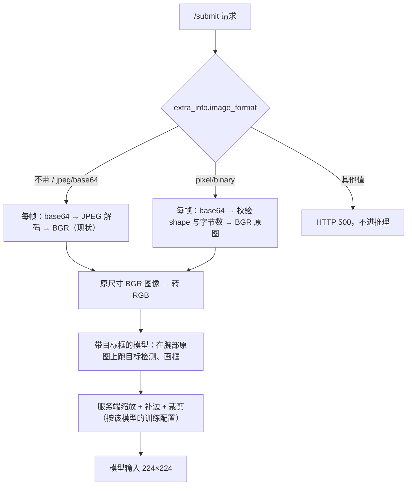

# 机器人图像传输：原始像素与 JPEG 两种格式

Oct 20, 2026（Oct 22 更新：服务端已实现，格式改由 `extra_info.image_format` 声明）

## 背景与目标

结论先行：请求在 `extra_info.image_format` 里声明图像格式。`"jpeg/base64"` 是默认值；`"pixel/binary"` 表示**原始像素**（不做 JPEG、不缩放、不补边）。不带这个字段的旧客户端照常工作。

- 现状：机器人每次请求对 3 路相机做 JPEG 编码（`cv2.imencode`，q100），实测约 **160 ms**，占掉一次推理往返的大头。
- 目标：把机器人端的图像处理降到接近 0，同时不改变模型看到的图像（与训练一致），也不破坏现有 JPEG 客户端。
- 范围：`/submit` 请求里的 `img_front` / `img_left` / `img_right`（及 `img_*_depth`）；动作回复、`/result` 不变。

## 为什么发原始像素，不发 PNG

原始像素在机器人端几乎不花时间，代价转移到网络：千兆有线下每次请求约 32 ms；PNG 编码比 JPEG 还慢 10–20 倍，在机器人上预计要 1.5–2.5 秒，是三者中最差的。

| 格式（3 路相机，640×512 + 2×640×480） | 每次请求体积 | 编码耗时（服务器 CPU 实测） | 编码耗时（机器人，按 50–80 倍估算） | 千兆网传输 | 百兆网传输 |
| --- | --- | --- | --- | --- | --- |
| **原始像素（`pixel/binary`）** | 2.8 MB（base64 后 JSON 体 3.8 MB） | 拷贝 0.1 ms + base64 1.6 ms + JSON 4 ms | 待测（见「客户端」的测速脚本） | 约 32 ms | 约 320 ms |
| PNG（压缩级别 1，最快档） | 1.0–1.75 MB（原始的 37–63%） | 28–47 ms | 1.4–2.4 s | 9–15 ms | 90–150 ms |
| PNG（默认级别 6） | 0.9–1.7 MB | 97–119 ms | 5–10 s | 8–14 ms | 80–140 ms |
| JPEG q100（`jpeg/base64`，现状） | 0.35–0.68 MB | 2–3 ms | **160 ms（机器人实测）** | 3–6 ms | 30–60 ms |

- 测量方法：用机器人实际发来的 3 帧 640×480 画面，在推理服务器上用 OpenCV 测得；体积区间的下端是干净画面，上端是叠加了常见传感器噪声的画面（噪声越大 PNG 越压不动）。
- 机器人列的倍数来自 JPEG：同样 3 帧在服务器上 2–3 ms，机器人上 160 ms。base64 与 JSON 不一定按同样倍数变慢，所以需要在机器人上实测。
- 网络：推理服务器网口为 1 Gbit/s。原始像素方案**要求机器人到服务器全程千兆有线**；百兆或 Wi‑Fi 下传输会比现在更慢。
- JPEG q100 仍是有损的；原始像素让模型看到的就是相机像素（服务端实测逐像素一致）。

## 请求格式

请求的其余部分不变；帧结构仍是 `{"data": ..., "shape": [...]}`，只是 `data` 的含义由 `extra_info.image_format` 决定，**对本次请求的所有相机生效**。

| `extra_info.image_format` | 帧的 `data` | `shape` |
| --- | --- | --- |
| 不带 / `""` / `"jpeg/base64"`（默认） | base64(JPEG 字节)，BGR —— 与现状完全相同 | 原样传，服务端不依赖 |
| `"pixel/binary"` | base64(原始像素字节)：彩色为 **BGR** uint8，`[H, W, 3]`；深度为小端 uint16，`[H, W]` | **必须**是图像本身的尺寸，字节数必须正好等于 H×W×3（深度 H×W×2） |

- 像素排列：行优先、HWC、连续内存，行尾无填充（`np.ascontiguousarray(img).tobytes()`）。通道顺序与 JPEG 路径一致，都是 BGR（OpenCV 的默认顺序），服务端统一转成模型需要的 RGB。
- **客户端绝不补边（padding），也不缩放**：发相机原图，`shape` 就是原图尺寸。补边、缩放、裁剪全部由服务端按各模型的训练方式完成。
- `extra_info` 可以是对象，也可以是它的 JSON 字符串。
- 出错即拒绝，服务端不猜格式：`image_format` 不认识、`shape` 不是 `[H, W, 3]`（深度 `[H, W]`）、字节数与 `shape` 对不上、base64 非法，`/submit` 都返回 HTTP 500 和 `{"status": "error", "message": "<原因>"}`，该请求不进入推理。
- 每路只需发最后 1 帧（服务端只用最后一帧）。
- 为什么放在 `extra_info`：`extra_info` 本来就是请求里的自由 JSON 字段，加一个键不改变任何现有字段的名称、类型或含义，协议库 `manifold_msg` 不用改。

### 新旧服务端

没有这项改动的旧服务端遇到 `pixel/binary` 帧会返回 **HTTP 500**（实测：JPEG 解码失败），不会把错误图像送进模型。客户端可以据此回退：收到 500 就改回 `jpeg/base64` 重发。

## 服务端处理流程

格式只影响解码一步，尺寸只影响缩放一步，两者互不相干。



实现：推理服务 `policy_server_ubt.py` 启动时给协议对象装一个钩子（新模块 `image_format.py`，manifold_model 提交 `44d59c3`）。`pixel/binary` 请求在进入协议库之前就解码成数组，JPEG 请求走协议库原来的路径，逐像素不变。请求之间没有共享状态。

已验证（在推理容器里用真实协议库、真实 HTTP）：

| 用例 | 结果 |
| --- | --- |
| 不带 `image_format`（旧客户端） | 200，与改动前相同 |
| `pixel/binary`，640×480 | 200，模型收到的图像与发送的逐像素相同 |
| `pixel/binary`，奇数尺寸 481×643 | 200，逐像素相同（不要求固定尺寸） |
| `pixel/binary`，`shape` 与字节数不符 | 500，带原因 |
| 未知格式（如 `"png"`） | 500，带原因 |
| 旧服务端收到 `pixel/binary` | 500 |

## 客户端

```python
import base64, numpy as np

def pixel_frame(img):
    """img：相机原图，HxWx3 uint8，BGR。不缩放、不补边、不做颜色转换。"""
    img = np.ascontiguousarray(img)
    assert img.dtype == np.uint8 and img.ndim == 3 and img.shape[2] == 3
    return {'data': base64.b64encode(img.tobytes()).decode('ascii'), 'shape': list(img.shape)}

request['extra_info'] = {**request.get('extra_info', {}), 'image_format': 'pixel/binary'}
request['img_front'] = [pixel_frame(head_bgr)]
request['img_left']  = [pixel_frame(left_bgr)]
request['img_right'] = [pixel_frame(right_bgr)]
# 收到 HTTP 500：服务端不支持（或帧有误），去掉 image_format、改回 JPEG 重发
```

注意：现有客户端库在编码前会把图像缩放到 `/info` 给的尺寸；发原始像素时请绕开这一步，直接发原图。

机器人端测速（请在机器人上跑一次，把输出发给我们）：

```python
import base64, json, time, numpy as np, cv2
ims = [np.random.randint(0, 256, s, np.uint8) for s in ((512, 640, 3), (480, 640, 3), (480, 640, 3))]
def ms(f, n=20):
    f(); t = time.perf_counter()
    for _ in range(n): f()
    return (time.perf_counter() - t) / n * 1000
body = lambda: json.dumps({'img': [base64.b64encode(i.tobytes()).decode('ascii') for i in ims]})
print('tobytes   %.1f ms' % ms(lambda: [i.tobytes() for i in ims]))
print('base64    %.1f ms' % ms(lambda: [base64.b64encode(i.tobytes()) for i in ims]))
print('b64+json  %.1f ms' % ms(body))
print('jpeg q100 %.1f ms' % ms(lambda: [cv2.imencode('.jpg', i, [cv2.IMWRITE_JPEG_QUALITY, 100]) for i in ims], 5))  # 随机噪声图上 JPEG 偏慢，仅作量级参考
```

- `b64+json` 低于约 30 ms：用本文的格式即可。
- 高于 30 ms：可以再加一种不经 base64 和 JSON 的二进制请求体（体积小 25%），属于另一项协议变更，需另行确认。
- 顺便确认机器人网口是否千兆：Linux 上 `cat /sys/class/net/<网口>/speed` 应为 `1000`。

## 状态与待办

- [x] 服务端实现与测试（`44d59c3`）。
- [ ] 部署：现有在线端点仍是旧代码，**暂不支持** `pixel/binary`；部署新代码的端点会另行通知。
- [ ] 机器人上跑测速脚本（`b64+json` 是否低于 30 ms）。
- [ ] 机器人到服务器是否全程千兆有线。
- [ ] 联调：同一端点对比机器人端到端延迟（JPEG vs 原始像素）。
